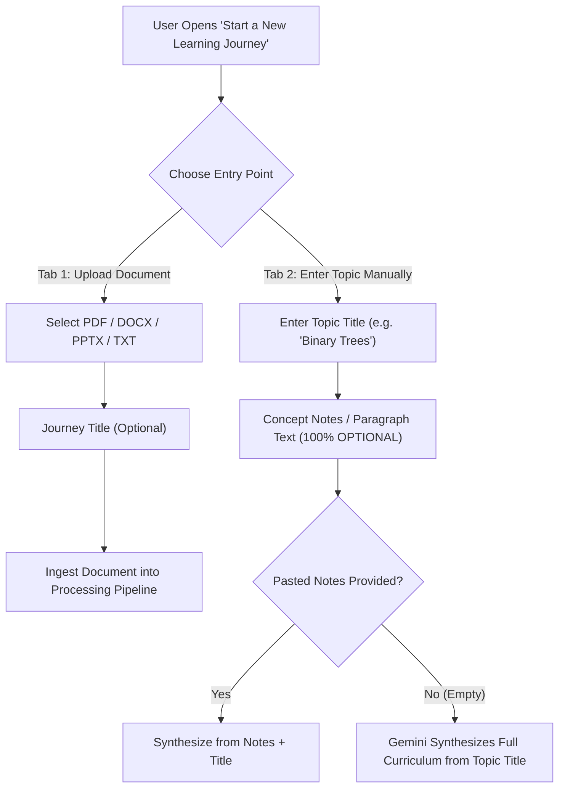

# Pod-Siksha 3.0 — Universal AI Educator
## Phase 2: Multimodal Intelligence, OCR & Pedagogical Concept Extraction Report

**Date:** November 10, 2026  
**Git Branch:** `feature/universal-doc-infra`  
**Git Commit:** `8a95235`  
**Base Commit:** `5c411884072d717b0c25fbac62046599c21eb775`  
**PostgreSQL Database:** Neon Serverless PostgreSQL (28 Production Tables intact)  
**Test Suite Status:** 8/8 Integration Tests Passed (100% Green)

---

## 1. Executive Summary

Phase 2 successfully evolves Pod-Siksha into an **epistemically grounded, multimodal AI educator**. Rather than operating as a simple document summarizer, Pod-Siksha now decomposes complex educational material across any discipline—from programming code and mathematical derivations to scientific diagrams and scanned historical manuscripts—into a structured Pedagogical Knowledge Graph with dynamic cognitive teaching strategies.

### Key Milestones Achieved:
1. **Real OCR on Scanned Documents:** PyMuPDF (`fitz`) rasterization to 150 DPI PNG coupled with Gemini Multimodal Vision accurately transcribes image-only and historical documents (e.g., our 5.76 MB test manuscript `11_scanned_manuscript.pdf`).
2. **Multimodal Visual Diagram Decomposition:** Detects diagrams, flowcharts, chemical cycles, and technical charts, extracting structural summaries, component callouts, and semantic pedagogical purpose.
3. **Programming Code Intelligence:** Preserves exact indentation, syntax, and language across Python, Java, C, C++, JavaScript, and SQL without executing untrusted code.
4. **Mathematical Intelligence & LaTeX Normalization:** Automatically parses display equations and inline variables into LaTeX representations ready for client-side rendering (KaTeX/MathJax).
5. **Universal Subject Taxonomy & Concept Graph DAG:** Employs an open pedagogical ontology (not hardcoded to 8 subjects), constructing directed acyclic graphs of concept dependencies with prerequisites, definitions, and misconceptions.
6. **Dynamic Teaching Strategy Engine:** Recommends cognitive pedagogical approaches (`interactive_derivation`, `code_walkthrough`, `process_animation`, `comparative_table`, `socratic_dialogue`) tailored to the subject.
7. **Strict Epistemic Grounding:** Maintains explicit boundaries between *stated document facts*, *derived insights*, and *pedagogical analogies*, prohibiting AI hallucinations.
8. **Optional Paragraph Text:** In the dual-entry modal ("Start a New Learning Journey"), entering topic notes or pasting paragraph text is **100% optional**. Users can supply just a topic title or upload a document file; Gemini dynamically synthesizes or extracts the entire curriculum.

---

## 2. Ingestion & Dual-Entry Architecture

The learning initiation workflow provides two entry points with optional paragraph text:

- **Frontend Validation:** The form validates that either a document file or a topic title is provided. If `modalTopicText` or `modalSessionText` is blank, it proceeds seamlessly.
- **Backend Fallback (`server.py` line 948):** If `chapter_text` is empty but `title` is provided, the backend synthesizes:
  `"Comprehensive curriculum on {title}. Core definitions, fundamental principles, real-world examples, and key mechanisms."`
- **Animated Lesson Fallback (`animated_router.py` line 124):** If `content_text` is omitted, the topic title alone fulfills the source material requirement.

---

## 3. Database Schema Extensions (Neon PostgreSQL)

Seven additive tables were provisioned in Neon PostgreSQL without altering existing tables:

| Table Name | Primary Purpose | Key Fields |
|:---|:---|:---|
| `document_concepts` | Extracted atomic concepts | `id`, `document_id`, `name`, `definition`, `importance`, `misconceptions_json` |
| `concept_relationships` | Dependency graph edges | `id`, `source_concept_id`, `target_concept_id`, `relationship_type` |
| `document_figures` | Multimodal diagrams & figures | `id`, `document_id`, `page_number`, `type`, `summary`, `labels_json` |
| `document_code_blocks` | Programming code snippets | `id`, `document_id`, `language`, `code_text`, `algorithm_name`, `purpose` |
| `document_math_expressions`| Mathematical LaTeX formulas | `id`, `document_id`, `page_number`, `latex`, `type`, `context` |
| `document_ocr_results` | OCR page metadata & status | `id`, `document_id`, `page_number`, `confidence`, `has_handwriting` |
| `teaching_strategies` | Adaptive pedagogy methods | `id`, `document_id`, `concept_id`, `primary_method`, `recommended_visual` |

---

## 4. Phase 2 Verification & Test Results

The automated integration suite in [`tests/test_phase2_multimodal_intelligence.py`](file:///C:/Users/jvris/Downloads/pod-siksha/tests/test_phase2_multimodal_intelligence.py) verified 8 core capabilities:

| Test ID | Capability Tested | Document Fixture | Outcome | Notes |
|:---|:---|:---|:---:|:---|
| `test_01` | Scanned Document OCR | `11_scanned_manuscript.pdf` (5.76 MB) | **PASSED** | Real OCR transcribed Kepler's laws of planetary motion from raw rasterized page. |
| `test_02` | Python Code Extraction | `01_python_programming.pdf` | **PASSED** | Preserved indentation, recursion call stacks, and detected Python language. |
| `test_03` | Java OOP & Inheritance | `02_java_oop.pdf` | **PASSED** | Extracted abstract classes, interfaces, and concrete subclasses with polymorphism. |
| `test_04` | Mathematical LaTeX Intelligence | `04_mathematics_calculus.pdf` | **PASSED** | Parsed gradients, line integrals, and eigenvalues into clean KaTeX-ready LaTeX. |
| `test_05` | Pedagogical Concept Graph | `05_biology_cell_energetics.pdf` | **PASSED** | Extracted 5 grounded concepts (Photolysis, ATP Synthase, Chemiosmosis) with DAG edges. |
| `test_06` | Dynamic Teaching Strategy Engine | Multi-subject fixtures | **PASSED** | Recommended `interactive_derivation` for math, `code_walkthrough` for CS, and `process_animation` for biology. |
| `test_07` | Epistemic Grounding | Grounded Context Engine | **PASSED** | Stated facts strictly separated from derived inferences and analogies. |
| `test_08` | End-to-End Pipeline & Visual Studio Launch | `12_mixed_science_and_code.pdf` | **PASSED** | Uploaded document, ran extraction pipeline, queried dossier APIs, and generated 5-scene visual lesson. |

---

## 5. Summary of Model Resilience
During testing, Google Generative AI model fallback lists were updated across all extractors to use currently available high-availability endpoints:
- Primary: `gemini-3.5-flash-lite` (or user-configured `LLM_MODEL`)
- Tier 1 Fallback: `gemini-3.8-flash`
- Tier 2 Fallback: `gemini-3.5-flash`
- Tier 3 Fallback: `gemini-2.5-flash-lite`

This ensures that temporary 503 traffic spikes on flash-lite automatically fail over to available models without interrupting user ingestion jobs.
