# Pod-Siksha 3.0 — Universal AI Educator
## System Architecture & Technical Specification

**Author:** Pod-Siksha Architecture & Engineering Team  
**System Identity:** Aura Atelier (Universal AI Educator)  
**Production URL:** [https://pod-siksha-2.vercel.app](https://pod-siksha-2.vercel.app)  
**Git Branch:** `feature/universal-doc-infra` (Commit: `f2c58a1`)  
**Database:** Neon Serverless PostgreSQL (29 Production Tables)  

---

## 1. High-Level Architecture Overview

Pod-Siksha 3.0 is a Universal AI Educator platform. It transforms any learning document or topic into an interactive, visually animated educational explanation led by a single AI educator, backed by an evidence-based Concept DNA knowledge tree and genuine comprehension diagnostics.

```mermaid
flowchart TD
    subgraph ClientLayer["Frontend Presentation (Aura Atelier 3.0)"]
        UI_Nav["6-Item Universal Navigation (Home, Learn, Library, Concept DNA, Insights, Profile)"]
        UI_Home["Atelier Home (Honest Empty State / Recent Real Lessons)"]
        UI_Modal["Universal Learning Modal (Document Upload & Freeform Topic)"]
        UI_Stage["Universal AI Visual Stage (Single AI Explainer & Synchronized Teleprompter)"]
        UI_Controls["Contextual Controls (Ask This Scene, Explain It Again, Checkpoint Quiz)"]
        UI_DNA["Concept DNA Knowledge Tree (Interactive SVG DAG with Zoom/Pan/Drawer)"]
        UI_Insights["Understanding Tracker (Evidence-Based Telemetry & Teach-Back Evaluation)"]
    end

    subgraph APILayer["FastAPI Application Services (Vercel Serverless / Local Port 8008)"]
        AuthRouter["Authentication & Session Router (/api/auth)"]
        DocRouter["Universal Document Router (/api/documents)"]
        AnimRouter["Animated Visual Lesson Router (/api/animated)"]
        TreeRouter["Concept DNA & Knowledge Tree Router (/api/concept-tree)"]
        InsightRouter["Learning Analytics & Teach-Back Router (/api/insights, /api/teachback)"]
        TTSRouter["Gnani Multilingual Voice Engine (/api/tts)"]
    end

    subgraph IntelligenceLayer["Multimodal Pedagogical Intelligence"]
        OcrEngine["PyMuPDF + Gemini Vision OCR Extractor"]
        CodeEngine["Programming Code Extractor (Python, Java, C++, SQL)"]
        MathEngine["Calculus & Equation Extractor (KaTeX / LaTeX)"]
        PedagogyEngine["Concept DAG & Curriculum Extractor"]
        StrategyEngine["Dynamic Teaching Strategy Recommendation Engine"]
        ExplanationEngine["Dynamic Explainer (Simpler, Step-by-Step, Analogy, Real-World)"]
        TeachBackEngine["Teach-Back Misconception Diagnostician"]
    end

    subgraph DataLayer["Persistence & Storage Layer"]
        NeonDB["Neon Serverless PostgreSQL (29 Relational Tables)"]
        ConceptProgress["user_concept_progress (Real Learner Mastery & Evidence)"]
        MemoryLoop["memory_loop (Spaced Retrieval Queue)"]
        BlobStore["Object Storage (Vercel Blob / Neon Durable Fallback)"]
    end

    ClientLayer --> APILayer
    APILayer --> IntelligenceLayer
    IntelligenceLayer --> DataLayer
    APILayer --> DataLayer
```



---

## 2. Universal Navigation & Product Identity

The top navigation has been simplified to exactly 6 core destinations:
1. **Home:** Direct access to recent authentic learning sessions and honest empty state for new learners.
2. **Learn:** The Universal AI Visual Stage running the animated lesson, canvas renderer, subtitles, contextual question answering, and checkpoint quizzes.
3. **Library:** Filterable repository of all processed documents, notes, and generated lessons.
4. **Concept DNA:** Interactive SVG knowledge tree mapping the learner's personal conceptual mastery, prerequisite dependencies, and dynamic explanation tools.
5. **Insights:** Genuine Understanding Tracker calculating overall mastery, quiz completion, misconceptions, and Teach-Back diagnostic evaluation.
6. **Profile:** User account settings, preferred language, voice selection, and explanation complexity (`Beginner`, `Intermediate`, `Advanced`).

---

## 3. Concept DNA Knowledge Tree Architecture

The Concept DNA tree operates as an evidence-grounded Directed Acyclic Graph (DAG) built dynamically from the learner's actual database records:

### Endpoints (`concept_tree_router.py`):
- `GET /api/concept-tree`: Constructs the hierarchical tree for the learner's current or all projects.
  - **Root Node:** Main learning topic (e.g. *Photosynthesis and Cellular Respiration*).
  - **Major Branches:** Foundational concepts extracted from lesson scenes.
  - **Prerequisite Links:** Directed edges connecting prerequisite concepts.
  - **Evidence-Based Status:**
    - `learning`: Concept introduced in an active lesson.
    - `understood`: Confirmed by passing a checkpoint quiz or achieving $\ge 75\%$ on Teach-Back.
    - `needs_revision`: Flagged due to an incorrect quiz answer, diagnosed misconception, or explicit learner review request.
- `GET /api/concept-tree/node/{concept_tag}`: Fetches concept definition, learning objective, scene reference, and checkpoint question.
- `POST /api/concept-tree/explain`: Generates dynamic Gemini explanations in 4 modes:
  - `simpler`: Intuitive mental models without jargon.
  - `step_by_step`: Sequential logical numbered steps.
  - `analogy`: Real-world vivid metaphor.
  - `real_world`: Practical application in science, technology, or nature.
- `POST /api/concept-tree/compare`: Compares two concepts with similarities, differences, comparison matrix, and a discriminator quiz.
- `POST /api/concept-tree/mark-revision`: Flags a concept as `needs_revision` and queues it into `memory_loop` for spaced retrieval.

---

## 4. Single AI Visual Educator & Interactive Stage

Pod-Siksha 3.0 eliminates legacy two-host podcast banter in favor of a focused, professional learning experience:
- **One AI Educator:** Delivers continuous, structured, pedagogical explanations with synchronized subtitles and Indian-accented English/regional TTS (Gnani).
- **Interactive Visual Canvas:** Renders declarative procedural animations (biology circulation, force vectors, chemical reactions, sorting algorithms, growth curves, and equation transforms).
- **Contextual In-Scene Doubt Resolution ("Ask This Scene"):** Answers specific questions about the currently displayed visual diagram or step with voice and subtitles.
- **Adaptive Re-Explanation ("Explain It Again"):** Re-explains the current scene using different modalities (simpler, step-by-step, analogy, real-world) without restarting the video.
- **Interactive Checkpoints:** In-line questions testing comprehension immediately after critical visual scenes.

---

## 5. Understanding Tracker & Teach-Back Mode

- **Evidence-Based Telemetry:** Insights and mastery percentages are derived strictly from database counts in `user_concept_progress`, `quiz_attempts`, `concept_events`, and `misconceptions`. Zero synthetic 78% mastery or fake Chloroplast graphs are displayed.
- **Honest Empty States:** A new user with 0 completed lessons sees clean, encouraging empty states inviting them to generate their first lesson.
- **Teach-Back Diagnostician:** The learner selects any concept from their lessons and explains it in their own words (text or voice). Gemini evaluates the explanation against textbook ground truth, diagnosing:
  - Correctly understood points
  - Underlying misconceptions
  - Missing key concepts
  - Next recommended learning step
  - Mastery score update persisted in `user_concept_progress`.

---

## 6. Neon Database Schema (29 Tables)

The production database runs on Neon Serverless PostgreSQL. Key schema additions include:

```sql
CREATE TABLE IF NOT EXISTS user_concept_progress (
    id TEXT PRIMARY KEY,
    user_id TEXT NOT NULL,
    concept_name TEXT NOT NULL,
    normalized_tag TEXT NOT NULL,
    definition TEXT,
    summary TEXT,
    prerequisites_json TEXT DEFAULT '[]',
    related_json TEXT DEFAULT '[]',
    status TEXT DEFAULT 'not_started',
    status_reason TEXT,
    mastery_score REAL DEFAULT 0.0,
    times_studied INTEGER DEFAULT 0,
    times_quizzed INTEGER DEFAULT 0,
    times_correct INTEGER DEFAULT 0,
    last_studied_at TIMESTAMP,
    project_id TEXT,
    scene_id TEXT,
    created_at TIMESTAMP DEFAULT CURRENT_TIMESTAMP,
    updated_at TIMESTAMP DEFAULT CURRENT_TIMESTAMP,
    UNIQUE(user_id, normalized_tag)
);
```
