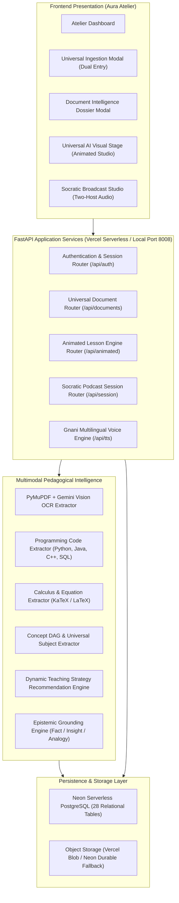
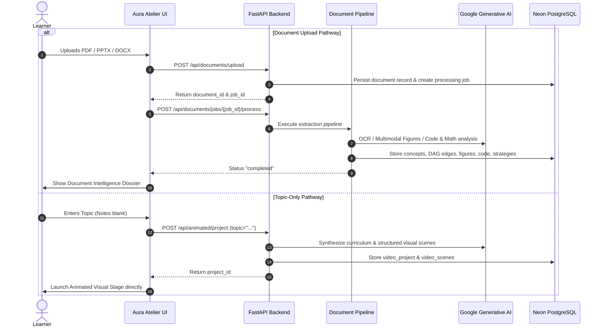

# Pod-Siksha 3.0 — Universal AI Educator
## System Architecture & Technical Specification

**Author:** Pod-Siksha Architecture & Engineering Team  
**System Identity:** Aura Atelier (Vedic Lumina)  
**Production URL:** [https://pod-siksha-2.vercel.app](https://pod-siksha-2.vercel.app)  
**Git Branch:** `feature/universal-doc-infra`  
**Database:** Neon Serverless PostgreSQL (28 Production Tables)  

---

## 1. High-Level Architecture Overview

Pod-Siksha 3.0 is a universal multimodal AI visual learning system. It accepts educational material in any format (scanned or digital PDFs, Word documents, slide decks, or pure topic queries) and transforms it into an interactive, epistemically grounded animated learning experience.

---

## 2. Ingestion & Dual Entry Architecture

Users can initiate learning through two pathways:
1. **Document Ingestion:** Upload any PDF (scanned or digital), DOCX, PPTX, or TXT file. The document is stored in durable object storage, queued into an asynchronous processing job, and parsed into atomic sections, figures, code blocks, and math expressions.
2. **Topic-Only Ingestion:** Enter a topic title (e.g. *"Quantum Entanglement"*, *"Binary Search Trees"*). The concept notes/paragraph text is **100% optional**. If omitted, Gemini generates the full curriculum from the topic title without requiring external text.

---

## 3. Multimodal & Pedagogical Extraction Pipeline

When an educational document is ingested, it traverses specialized extraction modules:

1. **OCR PDF Extractor (`extractors/ocr_extractor.py`):**
   - Detects pages without extractable text.
   - Rasterizes page surfaces to 150 DPI PNG buffers using PyMuPDF (`fitz`).
   - Streams visual pages to Gemini Multimodal Vision with strict JSON structuring.
   - Preserves original page numbers, headings, tables, and handwriting indicators.

2. **Multimodal Visual Diagram Extractor (`extractors/multimodal_extractor.py`):**
   - Isolates vector diagrams, biological cycles, electrical circuits, and flowcharts.
   - Generates semantic summaries, key visual callouts/labels, and pedagogical explanations.

3. **Programming Code Extractor (`extractors/code_extractor.py`):**
   - Heuristically identifies code blocks in Python, Java, C, C++, JavaScript, and SQL.
   - Preserves exact whitespace, 4-space indentation, and comments.
   - Enriches snippets with algorithmic names, expected inputs, and sample outputs.
   - **Never executes untrusted user or document code**.

4. **Mathematical LaTeX Parser (`extractors/math_extractor.py`):**
   - Extracts mathematical equations, differentials, integrals, and matrices.
   - Normalizes raw notation into standard LaTeX format ready for KaTeX rendering.

5. **Universal Pedagogical Concept DAG (`pedagogy/concept_extractor.py`):**
   - Dynamically determines the universal academic discipline (e.g. *Cell Biology*, *Theoretical Physics*, *Data Structures*).
   - Extracts atomic concepts with prerequisite dependencies, definitions, and diagnosed student misconceptions.

6. **Dynamic Teaching Strategy Engine (`pedagogy/teaching_strategy_engine.py`):**
   - Evaluates cognitive load, abstraction, and subject domain.
   - Maps concepts to proven pedagogical strategies:
     - *Mathematics & Physics:* `interactive_derivation`, `step_by_step_proof`
     - *Computer Science:* `code_walkthrough`, `algorithmic_trace`, `data_structure_visualizer`
     - *Biology & Natural Sciences:* `process_animation`, `structural_model`, `causal_flow`
     - *Humanities & Law:* `socratic_dialogue`, `comparative_table`, `historical_timeline`

---

## 4. Database Schema Specification (Neon PostgreSQL)

The system operates on **28 relational tables** partitioned into three generational clusters:

### Legacy Socratic Podcast Tables (17 Tables)
- `users`: User identity, hashed passwords, verification state, preferred language.
- `sessions`: Socratic audio podcast sessions with 14-turn dialogue scripts.
- `turns`: Script turns between Host A (Explainer) and Host B (Questioner).
- `doubts`: Socratic student questions and contextual audio answers.
- `quiz_sessions`, `quiz_questions`, `quiz_answers`, `quiz_results`: Quiz evaluation system.
- `concept_dna`, `concept_events`, `misconceptions`, `teachback_sessions`: Student mastery tracking.
- `voice_notes`, `exports`, `system_logs`, `auth_tokens`: Session and audit records.

### Animated Lesson Platform Tables (4 Tables)
- `video_projects`: Animated lesson metadata, learner profile, topic, language.
- `video_scenes`: Fully structured visual scenes with `narration_text`, `visual_spec` (elements, coordinates, actions), `subtitles_spec`, and `checkpoint_question`.
- `in_video_doubts`: Paused-video contextual student questions and real-time answers.
- `checkpoint_answers`: Learner responses to interactive multiple-choice questions.

### Universal Multimodal Document Intelligence Tables (7 Additive Tables)
- `documents`: Document file metadata, storage URL, total pages, primary subject.
- `document_processing_jobs`: Asynchronous processing lifecycle and error records.
- `document_concepts`: Extracted atomic concepts, definitions, Bloom's taxonomy level.
- `concept_relationships`: Directed dependency edges (`prerequisite_of`, `expands`, `contrasts_with`).
- `document_figures`: Extracted multimodal diagrams, coordinates, visual callouts.
- `document_code_blocks`: Extracted programming snippets, language, algorithm name, sample I/O.
- `document_math_expressions`: Extracted calculus and algebraic formulas in LaTeX.
- `document_ocr_results`: Scanned page OCR confidence, handwriting presence, and status.
- `teaching_strategies`: Recommended pedagogical method, animation type, and step plan.

---

## 5. Security, Isolation & Tenant Protection

1. **Authentication:**
   - Password hashing with salted PBKDF2/SHA-256.
   - Session bearer tokens with server-side validation.
   - Audio tag streaming supports query parameter authentication (`?token=...`) to prevent unauthorized media access while accommodating standard browser `<audio>` elements.

2. **Access Control & Tenant Isolation:**
   - Every document, podcast session, and animated project is tied to `user_id`.
   - All access handlers execute `verify_document_ownership`, `verify_session_ownership`, and `verify_project_ownership`.
   - Cross-tenant access attempts immediately terminate with HTTP 403 Forbidden.

3. **Sandboxing & Safe Processing:**
   - Extracted programming snippets are stored purely as inert strings for rendering; no arbitrary code execution is permitted.
   - Uploaded document sizes are strictly bounded, and files are processed inside isolated subprocess routines.
